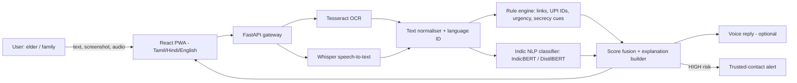

# Technical Design — Suraksha Saathi

## 1. Problem
Digital fraud preys on panic. Elders and first-time smartphone users, who read mostly regional languages, have nobody to ask in the moment. We provide instant, simple, multilingual help.

## 2. Architecture

## 3. Components
| Component | Choice | Why |
|---|---|---|
| API | FastAPI | Async, typed, auto docs |
| OCR | Tesseract (eng/hin/tam) | Offline, free, Indic support |
| Speech | Whisper | Strong multilingual accuracy |
| Classifier | Fine-tuned IndicBERT | Handles code-mixed Indian languages |
| Rules | Regex + link heuristics | Transparent, fast, works day one |
| Frontend | React PWA | Installable on low-end phones, no app store |

## 4. Scoring
`score = min(100, rule_weights + ml_score)`; levels: LOW < 30 ≤ MEDIUM < 60 ≤ HIGH. Every matched rule becomes a human-readable reason, so the user sees *why* a message is risky.

## 5. Data and training plan
Public scam-SMS datasets plus synthetic multilingual samples (scam templates translated and code-mixed), balanced with genuine bank/utility messages. Evaluate with precision/recall, prioritising low false-negatives on HIGH-risk classes.

## 6. Privacy and safety
Stateless analysis, no message storage by default, redaction of numbers in logs, explicit consent before any contact alert.

## 7. Limitations and roadmap
Rule-based baseline can miss novel scams; ML model improves coverage. Roadmap: WhatsApp bot, call-screening, community scam reporting feed, partnership with local NGOs and senior-citizen groups for field testing.

## 8. Testing
Unit tests on labelled sample data (`tests/`), plus planned user testing with elders for clarity of explanations.
